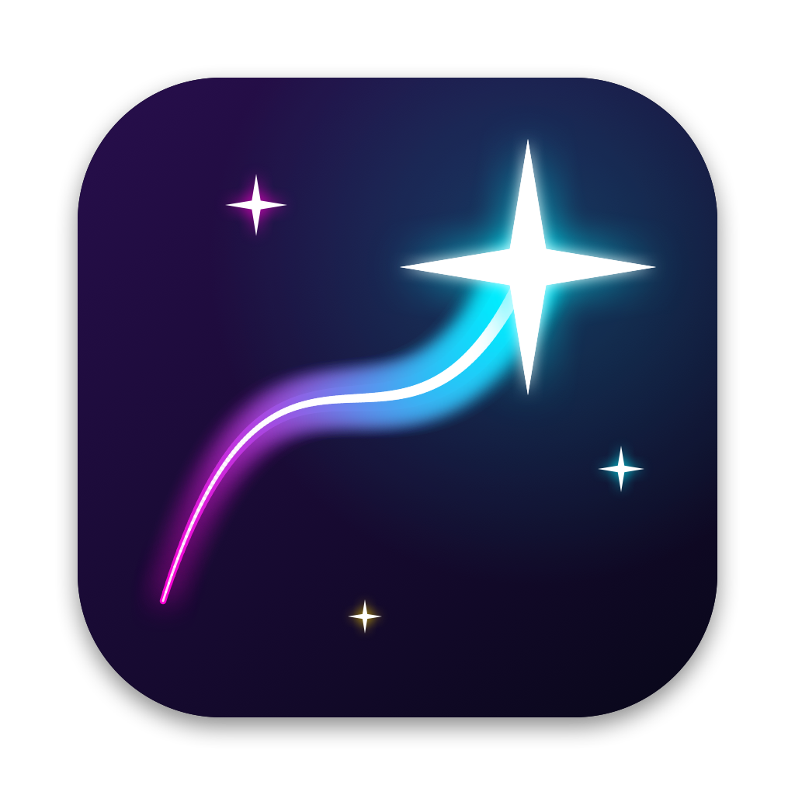
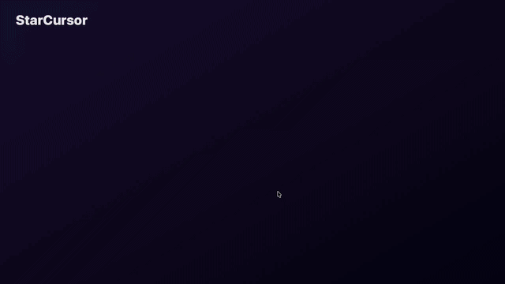
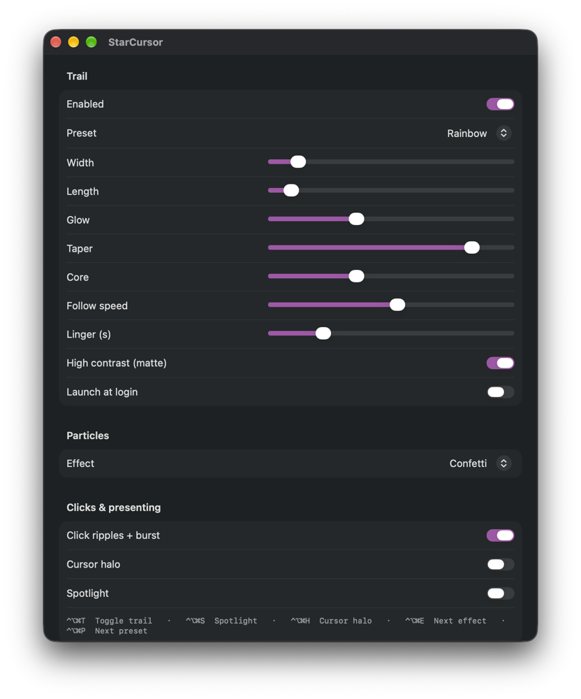
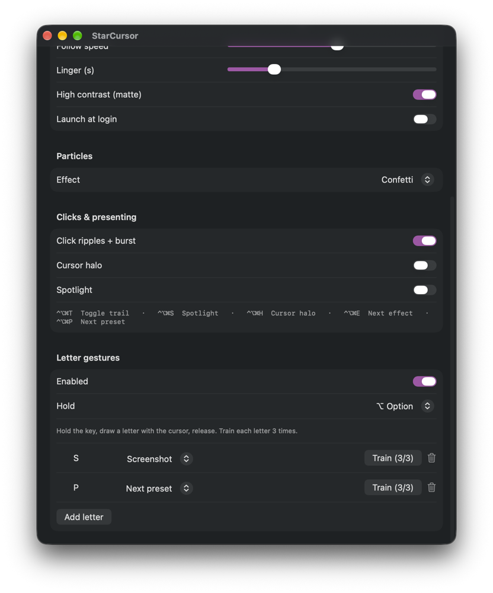

<p align="center">
  
</p>

<h1 align="center">StarCursor</h1>

<p align="center">
  <a href="https://github.com/simiriva95/starCursor/releases/latest"></a>
</p>

<p align="center">
  <b>A free, open-source neon cursor trail for macOS.</b><br>
  Glowing trails, glitter, confetti, GIFs, click ripples, a presenter spotlight and letter gestures.<br>
  One small native app. No account, no network, no tracking.
</p>

<p align="center">
  
</p>

<p align="center"><a href="docs/demo.mp4">▶︎ Watch the full-quality video (MP4)</a></p>

---

## Features

| | |
|---|---|
| **Neon trail** | Smooth, tapered glowing trail that follows your cursor across every app and every display. |
| **9 presets** | Neon, Synthwave, Fire, Ice, Toxic, Rainbow, Gold, Sakura, White. |
| **Fine-tuning** | Width, length, glow, taper, core brightness, follow speed, linger time. |
| **Particles** | Sparks, Glitter, Confetti, Emoji (pick your own), Bubbles, Snow. |
| **GIF mode** | Pick any animated GIF (or PNG/WebP): it rides along with the cursor, with optional echo copies down the trail. |
| **Click effects** | Ripple + particle burst on every click. Left and right clicks get different colors. |
| **Cursor halo** | A glowing ring that shows where your pointer is, and shrinks while you hold the button. |
| **Spotlight** | Dims the screen except around the cursor. Made for demos and screen recordings. |
| **High contrast** | Matte trail with a dark outline that stays readable on white pages. |
| **Letter gestures** | Hold <kbd>⌥</kbd>, draw a letter, release → open/quit an app, run a Shortcut, press keys, open a link, take a screenshot, mute, lock the screen, switch preset, toggle the trail. Trained on *your* handwriting (3 samples per letter), recognized fully on-device. |
| **Global hotkeys** | See below. No extra permission needed. |
| **Launch at login** | One toggle in Settings. |

### Global hotkeys

| Shortcut | Action |
|---|---|
| <kbd>⌃</kbd><kbd>⌥</kbd><kbd>⌘</kbd><kbd>T</kbd> | Toggle trail |
| <kbd>⌃</kbd><kbd>⌥</kbd><kbd>⌘</kbd><kbd>S</kbd> | Toggle spotlight |
| <kbd>⌃</kbd><kbd>⌥</kbd><kbd>⌘</kbd><kbd>H</kbd> | Toggle cursor halo |
| <kbd>⌃</kbd><kbd>⌥</kbd><kbd>⌘</kbd><kbd>E</kbd> | Next particle effect |
| <kbd>⌃</kbd><kbd>⌥</kbd><kbd>⌘</kbd><kbd>P</kbd> | Next color preset |

## Installation

**Requirements:** macOS 14 Sonoma or later, Apple silicon or Intel.

### Option A: download the app

1. Download `StarCursor-x.y.z.zip` from the [latest release](../../releases/latest).
2. Unzip it and drag **StarCursor.app** into your **Applications** folder.
3. Open it. StarCursor is free and not notarized by Apple, so the first launch is blocked. Allow it one of two ways:
   - **System Settings → Privacy & Security**, scroll down and click **Open Anyway** next to the StarCursor message, then confirm. **or**
   - in Terminal:
     ```bash
     xattr -dr com.apple.quarantine /Applications/StarCursor.app
     ```
4. A ✨ icon appears in the menu bar. That's the whole app: there is no Dock icon and no main window.

### Option B: build from source

You need the Xcode Command Line Tools (`xcode-select --install`).

```bash
git clone https://github.com/simiriva95/starCursor.git
cd starCursor
./build.sh
open StarCursor.app
```

`build.sh` compiles a universal binary with `swiftc`. No Xcode project or dependencies are needed. Run `./StarCursor.app/Contents/MacOS/StarCursor --selftest` to check the gesture recognizer and GIF decoder.

### Permissions

| Feature | Permission |
|---|---|
| Trail, particles, GIF, click ripples, halo, spotlight, hotkeys | **None** |
| Gestures *Press keys* and *Lock screen* | **Accessibility** (macOS asks on first use) |
| Gesture *Toggle mute* | **Automation** prompt the first time |

StarCursor reads only the cursor position and mouse-button state. It **never** records keystrokes, never captures your screen (except the *Screenshot* gesture, which saves to your Desktop), and makes no network requests.

### Uninstall

Quit from the menu bar, delete `StarCursor.app`, and optionally remove its settings:

```bash
defaults delete io.github.simiriva95.starcursor
```

## Usage

- **Menu bar ✨:** toggle the trail, pick a preset or effect, enable click ripples, halo or spotlight, open **Settings…**
- **Letter gestures:** in Settings → *Letter gestures*, add a letter, choose an action, click **Train** and draw the letter 3 times while holding <kbd>⌥</kbd>. From then on: hold <kbd>⌥</kbd>, draw, release.
- **GIF mode:** Settings → *Particles* → Effect **GIF** → **Choose…**

<p align="center">
  
  
</p>

## How it works

- A transparent, click-through `NSPanel` per display at screen-saver level. A 120 Hz loop polls `NSEvent.mouseLocation` and repaints only the dirty region with Core Graphics (glow comes from a shadowed transparency layer).
- Clicks are detected by polling `NSEvent.pressedMouseButtons`, so no event tap is needed and no permission is requested.
- Gestures use a `$1`-style template matcher without rotation invariance (so *N* ≠ *Z*), resampled to 48 points and scale-normalized.
- Hotkeys use Carbon `RegisterEventHotKey`.

```
Sources/
  main.swift       app delegate, menu bar, settings UI, hotkeys, self-test
  Trail.swift      presets, particle engine, overlay rendering, GIF decoding
  Gestures.swift   recognizer, gesture actions, synthetic key presses
tools/
  make-icon.swift  renders Resources/AppIcon.icns
  demo.swift       records docs/demo.mov on a neutral backdrop
```

## 🇮🇹 Installazione rapida

1. Scarica lo zip dall'ultima [release](../../releases/latest), estrai e trascina **StarCursor.app** in **Applicazioni**.
2. Al primo avvio macOS lo blocca (app gratuita non notarizzata): vai in **Impostazioni di Sistema → Privacy e sicurezza → Apri comunque**, oppure esegui `xattr -dr com.apple.quarantine /Applications/StarCursor.app`.
3. L'icona ✨ compare nella barra dei menu. Da lì scegli preset, effetti, spotlight e apri le Impostazioni.
4. In alternativa compila: `./build.sh && open StarCursor.app`.

## License

[MIT](LICENSE). Do whatever you like; a ⭐ is appreciated.
